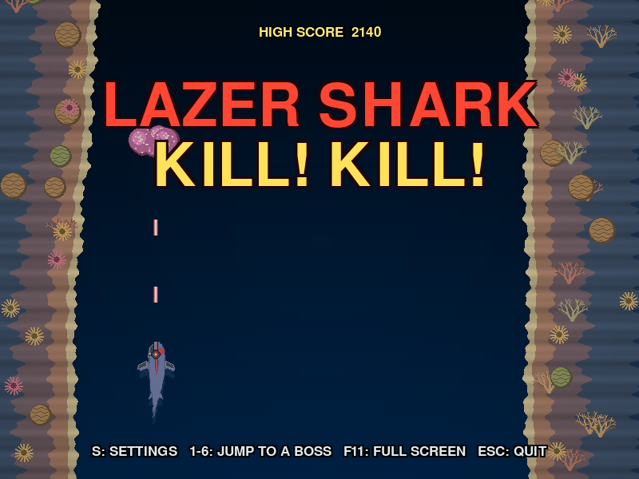
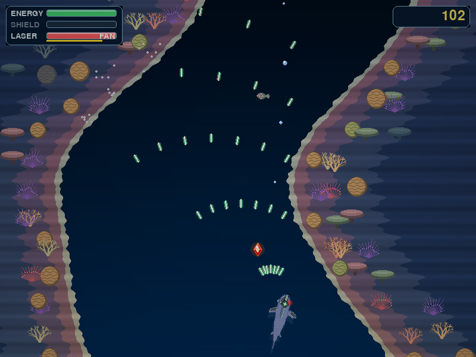
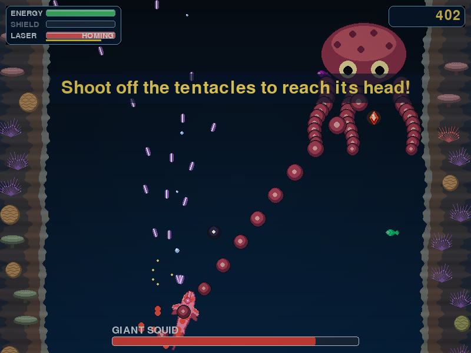
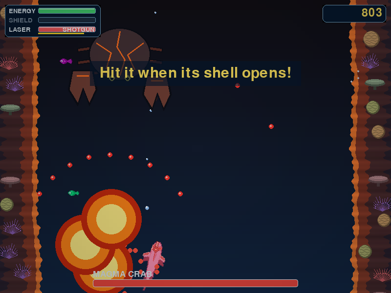
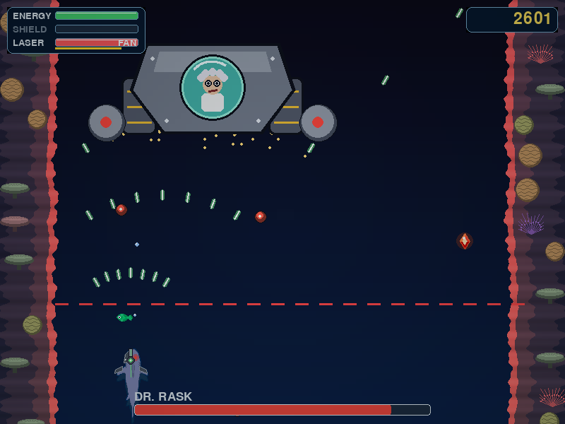

# 🦈 Lazer Shark Kill! Kill!

A top-down, vertically scrolling arcade shooter. You're Subject 13, a shark that escaped Dr. Rask's lab with a laser bolted to its head. Swim up a winding channel through six areas, beat a boss at the end of each, and take your revenge on Dr. Rask.




## 📥 Download

Get the latest version from the [Releases page](https://github.com/wheidal/LazerShark/releases/latest):
- **`LazerSharkKillKill_Setup_vX.exe`**: the Windows installer.
- **`LazerSharkKillKill_vX_Portable.zip`**: Windows, no install needed. Unzip it and run `LazerSharkKillKill.exe`.
- **`LazerSharkKillKill_vX_Mac_AppleSilicon.dmg`**: Macs with an M1 or later chip.
- **`LazerSharkKillKill_vX_Mac_Intel.dmg`**: Macs with an Intel chip. Open the disk image and drag the game into Applications.

The game isn't digitally signed:
- **Windows** warns that it's from an unknown publisher. Click **More info**, then **Run anyway**.
- **macOS** won't open it the first time. Click **Done**, then go to **System Settings > Privacy & Security** and click **Open Anyway**.

On Linux, run it from source (below).

## 🎮 The Game

- **Six areas and two interludes**: the Reef, the Ship Graveyard, the Flooded City, the Volcanic Rift, Atlantis, the NASA Graveyard, the Sunken Lab and the Lab Core. Each has its own look, music, obstacles, enemies and hazards.
- **Six bosses**, each fought differently: Giant Moray, Giant Squid, Magma Crab, Atlantean Guardian, Rival Shark and Dr. Rask in his walking mech.
- **A story**: an intro, Dr. Rask's radio taunts and an ending.
- **A weapon ladder**: laser, shotgun, rapid laser, fan laser and homing laser. Pickups move you up; getting hit knocks you down.
- **Eleven kinds of enemy**, from laser mantas and pufferfish to hammerheads and evil subs, getting tougher area by area.
- **Hazards** such as sea mines, depth charges, jellyfish, ink clouds, lava geysers, laser gates and electric cables.
- **Energy to manage**: it drains all the time, so eat fish to keep going.
- **High scores** with arcade-style initials, and your best score shown as you play.
- **Three difficulty levels**, plus an Easy Mode with unlimited laser.
- **Controller support** and remappable keys.

| | |
|---|---|
|  |  |
|  |  |

## 🕹️ How to Play

### Controls

| Action | Keyboard | Controller |
|--------|----------|------------|
| Move | Arrow keys | Left stick |
| Fire | Space | A |
| Pause | P | Start |
| Quit | Esc | |
| Full screen | F11 | |

Keys can be remapped in Settings. The controller is off until you switch it on there.

On the title screen, **S** opens Settings and **1-6** jump straight to a boss for practice.

### Tips

- **Energy** drains slowly, and faster while you move. Each fish gives +20. Grey fish with red X eyes are zombie fish: they bite.
- **Swimming into the coast** costs energy and pushes you back into the channel.
- **Weapon upgrades** (yellow hexagons) last 25 seconds. They drift in every 25 seconds, and also come from destroying tough enemies, evil subs and loot in giant wrecks.
- **Shields** absorb 100 damage for 20 seconds.
- **Watch for warnings**: red lines, glowing eyes and blinking lights mean something is about to fire, charge or blow up.
- **Bosses** each have a weak moment, and the game tells you what it is when the fight starts.

### Settings

Settings has key remapping, the controller switch, Easy Mode, music on or off, music volume and difficulty (Easy, Normal or Hard).

### High Scores

- The best 10 runs are kept, with three-letter initials and the difficulty they were played on.
- If you make the table, enter your initials on the Game Over screen: use the arrows or a D-pad to pick letters, or just type them.
- During play, your best score shows under your score, and turns into **NEW BEST!** when you pass it.
- Runs started by jumping to a boss, or played in Easy Mode, are practice and aren't recorded.

## 🚀 Running from Source

You need [Python 3.13](https://www.python.org/downloads/) on Windows, macOS or Linux.

```bash
git clone https://github.com/wheidal/LazerShark.git
cd LazerShark
python -m venv venv
```

Activate the virtual environment, with `venv\Scripts\activate` on Windows or `source venv/bin/activate` on macOS and Linux. Then:

```bash
pip install -r requirements.txt
python main.py
```

When run from source, settings and high scores are saved beside the code, in `game_settings.json` and `high_scores.json`. The installed game saves them in `%APPDATA%\LazerSharkKillKill` on Windows and `~/Library/Application Support/LazerSharkKillKill` on a Mac.

## 🔧 Development

### Project Structure

```
main.py              Game loop, menus and state
attract.py           Title screen demo and briefing pages
areas.py             The areas and interludes
channel.py           The scrolling coast and its zones
boss.py, bosses.py   The boss fights and the boss roster
enemies.py           Enemy types, spawning and toughening
obstacle.py          Obstacles, mines, barrels and jellyfish
hazards.py           Radiation, whirlpools and fields
features.py          Lava geysers, laser gates and electric cables
giant_wreck.py       Giant wrecks
weapons.py           The weapon ladder and its shots
food.py, powerup.py  Fish and pickups
highscores.py        High-score table and initials entry
story.py, cutscenes.py  Radio taunts, intro and ending
music.py             Music
hud.py               Energy, shield, laser and score display
settings_manager.py, resources.py  Settings and file paths
sounds/              Sound effects, and music in sounds/music/
tools/make_audio.py  Writes the placeholder music and sounds
tests/               Tests that play the real game without a window
```

[`shark_laser_arcade_spec.md`](shark_laser_arcade_spec.md) is the full design: every area, boss, enemy, hazard and number, plus what's still to do.

### Tests

The tests run the real game without a window or sound. They need Python 3.13:

```bash
pip install pytest
python -m pytest -q
```

The full run takes about 5-7 minutes.

### 📦 Building for Windows and Mac
GitHub builds everything for you (`.github/workflows/build.yml`):
- **Every pull request**, or **Actions > Build > Run workflow**: runs the tests, then builds the Windows installer, a portable Windows ZIP, and a Mac disk image for Apple Silicon and one for Intel. They're under the run's **Artifacts**.
- **Pushing a version tag** such as `v3.0.0` (`git tag v3.0.0 && git push origin v3.0.0`): the same, then a GitHub release with every file attached.

To build on a Windows PC instead, install Python 3.13 and [Inno Setup 6](https://jrsoftware.org/isdl.php), then:
```bash
pip install -r requirements.txt -r requirements_build.txt
python build_windows_installer.py --version 3.0.0
```
The game folder, the ZIP and the installer land in `dist/`. Only the files the game loads are bundled; see `LazerSharkKillKill.spec`.

To build on a Mac, install Python 3.13, then:
```bash
pip install -r requirements.txt -r requirements_build.txt
python build_mac_app.py --version 3.0.0 --smoke-test
```
This builds for the kind of Mac it runs on, Apple Silicon or Intel. The `.app` and the `.dmg` land in `dist/`.

Neither build is digitally signed:
- **Windows** warns that the installer is from an unknown publisher. Players click **More info**, then **Run anyway**.
- **macOS** refuses to open the game the first time. Players click **Done**, then go to **System Settings > Privacy & Security** and click **Open Anyway**. The `README.txt` in the disk image explains this.

### 🤝 Contributing

Contributions are welcome. For anything big, please open an issue first to talk it over.

1. Fork the repository.
2. Create a branch (`git checkout -b feature/my-idea`).
3. Make your change, and run the tests.
4. Push the branch and open a pull request.

## 🐛 Troubleshooting

- **No sound:** the game runs silently if it can't find an audio device. Check that the files in `sounds/` are there.
- **Controller does nothing:** switch it on in Settings, and connect it before starting the game. Most Xbox and PlayStation style controllers work.
- **Window too small:** press F11 for full screen.

## 📄 License

MIT. See [LICENSE](LICENSE).

## 🙏 Acknowledgments

- Built with [Pygame](https://www.pygame.org/).
- Inspired by classic arcade shooters.
- The music and sound effects are placeholders, generated by `tools/make_audio.py`.

---

**Enjoy the underwater mayhem! 🦈💥**

For questions, ideas or bug reports, please [open an issue](https://github.com/wheidal/LazerShark/issues).
